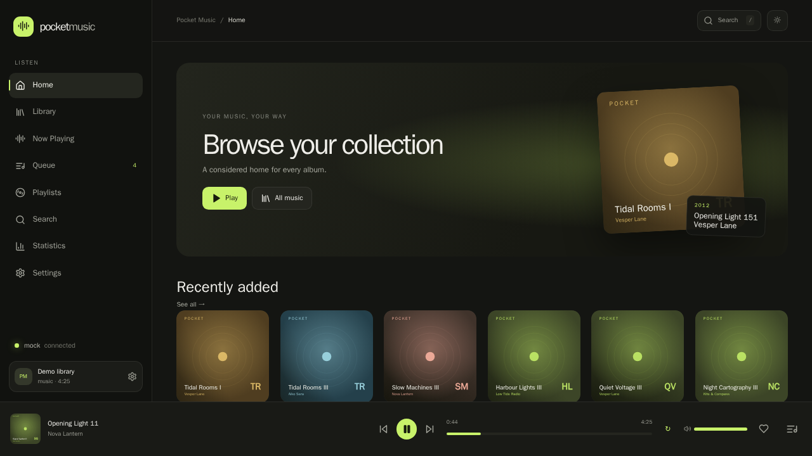

# Pocket Music


> **PocketJS port (product target):** `apps/pocket-music/pocket/` is the
> native PocketJS program (Solid TSX → `.pocket` → `pocket-linux-kms`). The
> `frontend/` tree remains the frozen React design reference and is not
> extended. Frames: `docs/pocket/`; verification:
> `apps/pocket-music/POCKETJS-VERIFICATION.md`.

A reference digital music player for desktop Linux, designed as the flagship
application for the future PJOS runtime.

Pocket Music fuses the things that made the classic players worth carrying: the
iPod's clear hierarchy, the Walkman's focus on the now-playing screen,
Foobar2000's library-first layout, and a modern streaming-era music library with
favourites, playlists and statistics. It is small enough to run on a 320×240
handheld and dense enough to browse a 10,000 track library on a desktop.



## What it is

| Layer     | Implementation                                              |
| --------- | ----------------------------------------------------------- |
| UI        | React 19 + TypeScript (Vite), three layouts, five input modes |
| Service   | Go `musicd` — library, scanning, metadata, queue, playback    |
| Storage   | SQLite (modernc.org/sqlite) with FTS5 full-text search         |
| Audio     | mpv controlled over its JSON IPC socket                        |

The UI never scans a folder, never opens an audio file and never talks to mpv.
Everything crosses the `musicd` HTTP API, which is the contract a PocketJS
runtime adapter will implement on PJOS.

## Quick start

Development (two processes, hot reload):

```sh
npm --prefix apps/pocket-music/frontend install
make dev                    # musicd on :8765, Vite on :5173
```

Open <http://127.0.0.1:5173>. With no music folder configured, start in demo
mode so every screen has content:

```sh
MUSICD_MOCK=true make dev
```

Single-binary desktop build (the service serves the compiled UI):

```sh
make build                  # build/musicd + frontend/dist
make serve                  # MUSICD_WEB_DIR=… MUSICD_MOCK=true ./build/musicd
```

Open <http://127.0.0.1:8765>. Set `MUSICD_MUSIC_DIR` to a real folder and use
**Settings → Scan library** to index MP3, FLAC, AAC, M4A, OGG, WAV and APE files.
`make test` runs the Go suite, the frontend type check, the pure-logic unit
tests and the i18n catalog parity check.

## Features

- **Home** — recently added, recently played, most played, favourite tracks and
  favourite albums, all backed by the service.
- **Library** — songs (paged, 10k-ready), albums, artists, genres, folders and
  favourites, with per-view search.
- **Album and artist pages** — cover, year, play all, add to queue, favourite,
  album track lists ordered by disc track number.
- **Now Playing** — album art, timeline, transport, volume, playback mode
  (normal / repeat all / repeat one / shuffle), favourite, synced lyrics and the
  next four queue entries.
- **Queue** — play next, add to queue, remove, clear, and drag-to-reorder.
- **Playlists** — create, rename, delete, add/remove/reorder tracks, import and
  export M3U and M3U8.
- **Favourites** — tracks, albums and artists, surfaced on Home and in the
  Library.
- **Search** — instant, grouped by songs, albums, artists and playlists.
- **Statistics** — listening time, plays, skips, completion rate, top artists,
  top albums, most played and most skipped.
- **Settings** — three layouts, light/dark/system themes, English / 简体中文 /
  日本語, music folder, scan with progress and cancellation, scan on startup,
  cover cache size and audio output.
- **Covers** — stored art, `folder.jpg`/`cover.jpg`, embedded art extracted with
  ffmpeg, and a deterministic generated cover so a library without art still
  looks intentional.
- **Input** — mouse, touch, keyboard (`Space`, arrows, `/`, `Esc`) and gamepad
  (A, shoulder buttons, D-pad, analog stick).
- **Responsive from 320×240 to 1920×1080**, including 640×480, 720×720 and
  480×320, at DPI 1×/1.5×/2×/3×.

## Device layouts

| Layout    | Character                                            | Best for              |
| --------- | ---------------------------------------------------- | --------------------- |
| `music`   | Album-forward shell with a fixed sidebar             | Desktop, 1280×720+    |
| `library` | Foobar-style: tab rail plus a dense list             | Library work, desktop |
| `minimal` | No chrome, drawer navigation, Now Playing first      | 320×240 … 480×320     |

Layouts, theme and language can be set in Settings or through URL parameters
(`?view=now&theme=light&lang=ja&layout=minimal`), which makes every screenshot
and deep link reproducible.

## Screenshots

The full matrix — Home, Library, Albums, Artists, Genres, Folders, Favourites,
Album, Artist, Now Playing, Queue, Playlists, Playlist, Search, Settings and
Statistics in both themes at six viewport sizes plus 1.5×/2×/3× DPI — lives in
[`apps/pocket-music/docs/screenshots`](apps/pocket-music/docs/screenshots) and is
indexed in [SCREENSHOTS.md](apps/pocket-music/docs/SCREENSHOTS.md).

## Tests

```sh
make test        # go test ./... + tsc --noEmit + node:test + i18n parity
make bench       # 10,000 track API benchmarks
make screenshots # re-capture the matrix against a running instance
```

Current state: 19 Go tests, 5 library-scale benchmarks, 16 frontend unit tests,
141 translated keys across three languages, and 46 captured screenshots with zero
layout failures.

## Documentation

- [README](apps/pocket-music/docs/README.md) — product and operations guide.
- [ARCHITECTURE](apps/pocket-music/docs/ARCHITECTURE.md) — service boundaries,
  playback state machine, providers, PJOS migration.
- [DATABASE](apps/pocket-music/docs/DATABASE.md) — schema, indexes, FTS5.
- [API](apps/pocket-music/docs/API.md) — every route and payload.
- [ROADMAP](apps/pocket-music/docs/ROADMAP.md) — status and what remains.
- [SCREENSHOTS](apps/pocket-music/docs/SCREENSHOTS.md) — capture matrix and
  layout audit evidence.

## Limitations

- Audio output depends on a local mpv build; `MUSICD_AO=null` is the default so
  headless hosts and CI can still exercise playback state.
- Remote providers (Bilibili, Navidrome, Jellyfin) are defined by the
  `MusicProvider` interface but not implemented.
- The PocketJS/PJOS runtime adapter is not part of this repository; the API and
  input model are designed for it. See [ROADMAP](apps/pocket-music/docs/ROADMAP.md).
